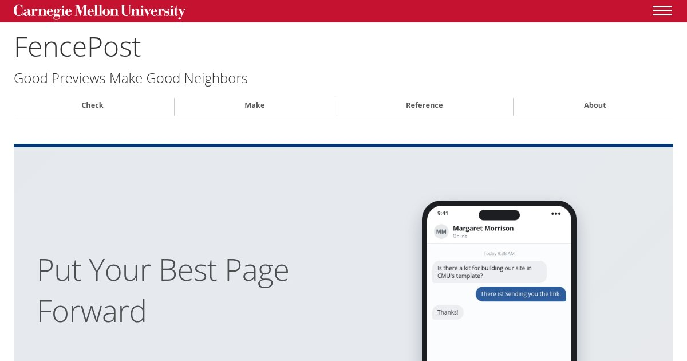

# FencePost

FencePost, named for the Fence, where Carnegie Mellon students paint what
they want everyone to see, makes link previews for Carnegie Mellon websites.
Give it a page, and it makes the image that shows when someone shares the
link (1200 × 630, under 300 KB) and the Open Graph tags that go with it. It
also checks a published page's preview, and takes screenshots of a page for
a mockup or the CMU Web Gallery.

Site: https://fencepost.andrew.cmu.edu/

[](https://fencepost.andrew.cmu.edu/)

## Use It

On the site, check a page's link preview, generate a preview image and its
tags, or take a screenshot. FencePost follows the Carnegie Mellon Web Kilt's
[Link Previews / Open Graph](https://webkilt.andrew.cmu.edu/0/previews.html)
standard. To make a site's preview as it's built, use the
[workflow action](#workflow-action); for WordPress, the
[plugin](#wordpress-plugin).

## Approved Sites

FencePost generates previews for public pages, the way a social site sees them.

- **Carnegie Mellon sites:** any page on `cmu.edu` or any of its
  subdomains. The check matches the end of the hostname exactly, so
  `notcmu.edu` and `cmu.edu.example.com` are refused.
- **Other Carnegie Mellon sites:** domains listed in `domains.json`, for sites
  run by a Carnegie Mellon department, center, office or recognized student
  organization (e.g., abtech.org). Each entry records the group, the date it
  was added and the request. To add one, open a
  [Request a Domain](https://github.com/cmu-web/cmu-web-fencepost/issues/new?template=domain_request.yml)
  issue; an approved request is a pull request that adds a line. The list is
  reviewed once a year, and domains that no longer belong to a Carnegie Mellon
  group are removed.
- **Only public pages.** FencePost looks up each host with public DNS and
  refuses private, loopback and link-local addresses, which is where campus-only
  hosts live. It checks the allowed domains and addresses again after every
  redirect, and fetches signed out, so a page behind a sign-in fails
  instead of turning into an image.

## Screenshots

FencePost's Screenshots page (and `POST /api/screenshot`) takes a screenshot
of a page's top with the same rules as a link preview: a public page on a
site FencePost captures, signed out, with the menu closed. For a page with
loading animations or delayed images, it can wait up to 10 seconds
after the page loads first (`delay`, in whole seconds; the wait adds to the
capture's 20-second limit rather than counting against it). It makes two
kinds, as WebP:

- **A mobile view:** 430 × 790 at double resolution, the screen of the Web Kilt's
  phone frame (`cmu-shot--phone`), with a phone's status bar across the top
  in the page's own top color. The time, signal and battery are white or
  near-black, whichever reads better, and the frame's camera cutout sits
  over the bar.
- **A card:** 1040 × 656, the page on a computer, for the CMU Web Gallery and the project cards on each About page.

## WordPress Plugin

`packages/wordpress` is a WordPress plugin, FencePost Link Previews. When a
page or post is published or updated, it asks `POST /api/preview` for the
page's preview, saves the JPEG in the media library and uses it for that page,
unless the page has a featured image. It works with the Forbes & Moreword
theme and the common SEO plugins, and writes the image tags itself when nothing
else does. Only the page's public address and the site's name are sent.
Each release attaches it as `fencepost-wordpress.zip`; see
[its README](packages/wordpress/README.md).

## Workflow Action

`action.yml`, the Make Preview Images action, makes a site's preview image and
screenshots in a GitHub or Forgejo workflow, so they're ready when the site
goes live. The workflow builds the site and
serves it inside the job, and the action captures it there.

- It captures any address the job can reach, including `127.0.0.1`, with no
  list of sites. It never calls the FencePost website.
- It runs FencePost's release container image of the same version with Docker, so it
  works on Linux runners with Docker.
- It writes only the files you name, relative to the workspace.

### GitHub

```yaml
- name: Serve the built site
  run: |
    python3 -m http.server 4000 --bind 127.0.0.1 --directory _site &
    until curl -fs http://127.0.0.1:4000/ >/dev/null; do sleep 1; done
- uses: cmu-web/cmu-web-fencepost@0.2.1
  with:
    url: http://127.0.0.1:4000/
    preview: _site/images/preview.jpg
```

### Forgejo

Name the action by its full address. The job runs in a container, so the
runner has to mount the Docker socket (`docker_host: automount` under
`container` in the runner's config), and the job's image has to include the
Docker command line.

```yaml
- uses: https://github.com/cmu-web/cmu-web-fencepost@0.2.1
  with:
    url: http://127.0.0.1:4000/
    preview: _site/images/preview.jpg
```

How it finds the job: on a Forgejo runner it joins the container named in
`JOB_CONTAINER_NAME`; in any other job container (`/.dockerenv`), the one
named by the hostname; otherwise it's on the runner itself. In a container it
shares that container's network and volumes (`--network container:`,
`--volumes-from`); on the runner it uses the host's network and mounts the
workspace.

### Inputs and Outputs

Inputs: `url` (required), `preview` (default `images/preview.jpg`, blank to
skip), `card` and `phone` (blank by default; the extension picks WebP, PNG or
JPEG), `public-url`, `site` and `image-path` for the tags, `delay` (seconds
to wait after the page loads, 0 to 10), and `container-image`, the FencePost container image to run (default: the
release's; set it to test one the workflow just built). Outputs: `title`, `description`, the paths written and
`tags`. The Reference page has the details.

The same runs from a checkout on your own computer; see
[Development](DEVELOPMENT.md#capture-from-a-checkout).
